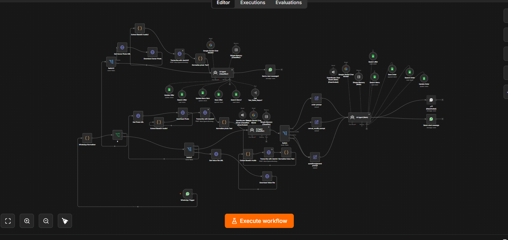

# Restaurant AI Order Assistant — WhatsApp Ordering + Owner Admin Bot

An AI assistant that runs on a **single WhatsApp number** and handles two jobs at once:

- **Customers** place, change, and cancel delivery orders in natural conversation, by text, voice note, or photo.
- **The restaurant owner** uses the same number to update menu prices, add or remove offers (including from a photo), and ask for sales reports — no spreadsheet editing.

Built on **n8n**, with **Google Gemini** for understanding messages and **Google Sheets** as the live database.

> **Status:** currently in a trial phase.



* * *

## 🧩 What it does

### Customer side

- Accepts **text, voice notes, and photos**. Voice and images are sent to Gemini and converted to text before anything else happens.
- An **AI classifier** reads each message and routes it to one of four intents: `order`, `cancel_modify`, `questions`, or `general`.
- **Placing an order:** the agent checks every item and price against the menu sheet (it never guesses), collects name, delivery address, phone number, and items, calculates the total, reads the full order back, and only saves it after the customer explicitly confirms. If the customer changes something after the read-back, it re-confirms before saving.
- **Cancelling or modifying:** the agent finds the customer's latest order and checks its status. Orders that are `new` or `preparing` can be changed or cancelled; orders that are `out_for_delivery` or `delivered` are refused with a polite message.
- **General questions** (hours, location, delivery) are answered from restaurant info stored in the prompt.
- Each customer gets their own **conversation memory**, so the agent understands follow-ups like "add one more to that".
- A "new order" message template (name, address, phone, items, total) is sent to the **cashier's WhatsApp number**.

### Owner / manager side

The workflow recognises the owner by phone number and sends their messages to a separate admin agent:

- **Menu updates:** looks up the item first, applies the change, and confirms old price → new price.
- **Offers:** the owner can send a photo with a caption, or describe the offer in plain text. The agent saves it with status `active` and always resolves the expiry date to a real calendar date. Offers can be ended (status `removed`) or listed.
- **Sales reports:** number of orders, total revenue, and best-selling item for `today`, `yesterday`, or `week`, calculated from real order data by a sub-workflow.

* * *

## 🏗️ Architecture

```
WhatsApp message
      │
      ▼
 WhatsApp Trigger ──► Normalizer (unifies text / image / audio into one format)
                           │
                  Is the sender the owner?
              ┌────────────┴─────────────┐
            No (customer)             Yes (owner)
              │                          │
  photo / voice → Gemini → text    photo → Gemini → text
              │                          │
      AI Classifier                 Admin Agent
  (order / cancel_modify /         tools: Search Menu, Update Menu Item,
   questions / general)                   Save / Search / Update Offer,
              │                           Get_Sales_Report
      Matching prompt                      │
              │                      Reply to owner
        Main Agent
  tools: Search Menu, Save Order,
         Search Order, Update Order,
         Search Offers
              │
   Reply to customer  +  alert to cashier
```

* * *

## ⚙️ Tech stack

- **n8n** — all logic is built as one workflow plus a sales-report sub-workflow
- **Google Gemini** (flash / flash-lite models) — the chat agents, plus voice and image to text
- **WhatsApp Business Cloud API** — customer and owner interface
- **Google Sheets** — menu, orders, and offers
- OpenRouter chat-model nodes are included but **disabled** (kept as an alternative model provider)

### Google Sheet layout

One spreadsheet with three tabs:

| Tab | Purpose | Columns |
|---|---|---|
| 1 | Menu | `name`, `price`, `description` |
| 2 | Orders | `order_id`, `customer_name`, `customer_phone`, `delivery_address`, `items`, `total_price`, `status`, `created_at` |
| 3 | Offers | `offer_id`, `offer_name`, `description`, `price`, `expiry_date`, `telegram_file_id`, `status` |

* * *

## 🔧 Setting this up yourself

This file is an n8n export with all personal data replaced by placeholders, so it is **not plug-and-play**.

1. **Import** `Restaurant_Automation.json` into n8n.
2. **Create credentials** and select them in the nodes that show a missing credential: WhatsApp Business Cloud API, WhatsApp Trigger (OAuth), Google Sheets (OAuth), and Google Gemini (API key). The `REPLACE_WITH_YOUR_CREDENTIAL_ID` values in the file only mark where credentials go.
3. **Create the Google Sheet** with the three tabs and columns above, then re-select it in every Google Sheets node (`YOUR_GOOGLE_SHEET_ID`).
4. **Replace the phone placeholders** (digits only, with country code and no `+`, for example `20XXXXXXXXXX`):
   - `YOUR_OWNER_PHONE_NUMBER` in the `If` node and the `Send a text message2` node
   - `YOUR_CASHIER_PHONE_NUMBER` in the cashier node
   - `YOUR_WHATSAPP_PHONE_NUMBER_ID` in the WhatsApp send nodes
5. **Fill in the restaurant details** (working hours, location, delivery area) in the `questions/general prompt` node.
6. **Create the sales-report sub-workflow** (`Get_Sales_Report`, takes a `period` of `today`, `yesterday`, or `week`) and re-select it in the `Call 'Get_Sales_Report'` tool node.
7. **Register the webhook** from the WhatsApp Trigger node in your Meta app, then activate the workflow.

* * *

## 💡 Design decisions

- **Per-client deployment:** each restaurant gets its own workflow instance and its own sheet, so data stays private and independent.
- **Tools over guessing:** menu items, prices, and order status always come from the sheet, never from the model's memory.
- **Confirm before saving:** an order is only written after the customer confirms the final read-back.
- **Status-aware changes:** the order's status decides what can still be changed, so dispatched orders are never edited by the bot.
- **Two agents, two audiences:** customers and staff get different instructions, tools, and tone.

* * *

## ⚠️ Current limitations

- **Trial phase:** not yet running at scale in production.
- **Sales report sub-workflow is separate** and not included in this export. Only `today`, `yesterday`, and `week` are supported.
- **One owner number:** the owner is identified by a single phone number set in the `If` node.
- **Owner voice notes are not handled:** the owner can send text or photos only.
- **Google Sheets as the database:** fine for a single restaurant, not designed for high order volume.
- **No error workflow is configured** yet, so a failed run is not reported automatically.
- **Leftover naming from an earlier Telegram version**, such as the `telegram_file_id` column, remains in the offers sheet.
